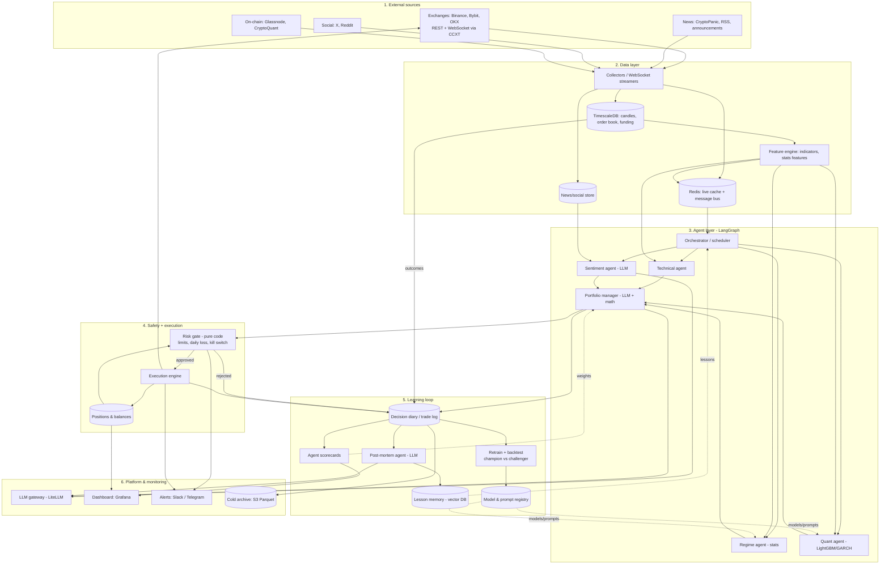

# agentic-trader

A self-improving, multi-agent crypto trading system. Specialist agents analyze markets (technical, sentiment, regime, quant), a portfolio manager combines their views, a hard-coded risk gate protects capital, and a learning loop makes the system better from its own track record every day.

> ⚠️ **Status: research / paper trading only.** Trading crypto is risky. This project runs on exchange testnets until it proves itself. Nothing here is financial advice.

## Goals

- Multi-agent architecture that spawns analysts on demand (per symbol, per event)
- Combine market, sentiment, and statistical analysis into one decision
- Learn from mistakes via scorecards, written lessons, and gated retraining
- Model-agnostic: swap in newer LLMs through config, validated by replay
- Safety first: risk limits that no agent can override

### Success metrics
Win rate alone is misleading. We measure:
- Positive expectancy after fees and slippage
- Sharpe ratio > 1 (walk-forward, out-of-sample)
- Max drawdown < 15%
- Live paper results closely matching backtests

## Architecture



Source: [`docs/architecture.mmd`](docs/architecture.mmd)

### Agents

| Agent | Responsibility | Engine |
|---|---|---|
| Orchestrator | Selects symbols, triggers runs (timer + events), spawns analysts | Code + small LLM |
| Technical | Indicators (RSI, MACD, MAs, ATR, Bollinger), patterns, breakouts | Code |
| Sentiment | Scores news, X, Reddit, and exchange announcements | LLM |
| Regime | Classifies trending / ranging / volatile | Stats |
| Quant | Return/volatility forecasts, signal strength | LightGBM, GARCH |
| Portfolio manager | Weighs reports, sizes positions | LLM + math |
| Risk gate | Position limits, daily loss limit, kill switch | Pure code, never self-modifies |
| Execution | Order placement, retries, fill tracking via CCXT | Code |
| Post-mortem | Reviews outcomes, writes lessons | LLM |

Each analyst returns a structured report: `{symbol, signal: long|short|flat, confidence: 0-1, horizon, reasons[]}`.

### Learning loop

1. **Decision diary:** every report, decision, order, and the actual outcome at 1h / 4h / 24h.
2. **Scorecards:** per-agent accuracy and confidence calibration, broken down by regime.
3. **Adaptive weighting:** the portfolio manager trusts agents by their recent, regime-specific scorecard.
4. **Reflection:** a nightly post-mortem writes concrete lessons into vector memory. The most relevant lessons get injected into prompts. Stale lessons are retired.
5. **Champion vs. challenger:** models, prompts, and new LLMs only go live if they beat the current version on walk-forward backtests and diary replay.

### Data retention
- Hot (30–90 days): full detail in TimescaleDB
- Warm: daily and weekly rollups used by agents
- Cold: compressed Parquet on S3 for audits and retraining
- Memory: a curated, bounded lesson set. Only the top-k most relevant lessons are retrieved, so prompt size stays flat as history grows.

## Tech stack

| Area | Choice |
|---|---|
| Language | Python 3.11+ |
| Exchange access | [CCXT](https://github.com/ccxt/ccxt) (Binance testnet first) |
| Backtesting | [vectorbt](https://github.com/polakowo/vectorbt), [Freqtrade](https://github.com/freqtrade/freqtrade) as reference |
| Agents | [LangGraph](https://github.com/langchain-ai/langgraph) |
| LLM gateway | [LiteLLM](https://github.com/BerriAI/litellm) |
| Stats / ML | pandas, numpy, statsmodels, scikit-learn, LightGBM, arch |
| Storage | TimescaleDB (Postgres), Redis, pgvector, S3/Parquet |
| Ops | Docker Compose, Grafana, Slack/Telegram alerts |

## Project structure (planned)

```
agentic-trader/
├── docs/
│   └── architecture.mmd
├── config/               # settings, risk limits, model routing
├── src/agentic_trader/
│   ├── data/             # collectors, storage, feature engine
│   ├── agents/           # orchestrator, analysts, portfolio manager, post-mortem
│   ├── risk/             # risk gate, kill switch
│   ├── execution/        # CCXT order management
│   ├── learning/         # diary, scorecards, memory, retraining
│   ├── backtest/         # backtests, walk-forward validation
│   └── llm/              # LiteLLM gateway, prompts
├── tests/
├── docker-compose.yml
├── .env.example
└── README.md
```

## Getting started

```bash
git clone <repo-url> agentic-trader && cd agentic-trader
cp .env.example .env      # add Binance TESTNET keys and LLM API key
docker compose up -d      # TimescaleDB, Redis, Grafana
pip install -e .
```

### API key safety
- Use **testnet** keys during development
- Live keys: trading only, **withdrawals disabled**, IP whitelist enabled
- Never commit `.env`

## Roadmap

- [ ] **Phase 1: Foundations.** Repo, config, Docker stack, CCXT testnet connection
- [ ] **Phase 2: Data.** Candle/order-book/funding collectors, news ingestion, feature engine
- [ ] **Phase 3: Baseline.** Rule-based strategy, backtester, risk gate, execution on testnet
- [ ] **Phase 4: Agents.** Orchestrator plus analysts, portfolio manager, structured reports
- [ ] **Phase 5: Learning.** Diary, scorecards, adaptive weights, post-mortem, lesson memory
- [ ] **Phase 6: Validation.** Walk-forward tests, champion/challenger, model replay
- [ ] **Phase 7: Paper trading.** 3+ months on testnet with dashboards and alerts
- [ ] **Phase 8: Live (small).** Small capital, strict limits, gradual scaling

## Risk rules (non-negotiable)

- Spot only until paper results are consistently profitable. No leverage early on.
- Max position size and max total exposure are set in config
- Daily loss limit trips the kill switch automatically
- The risk gate is code only. No LLM can bypass or edit it.

## Disclaimer

This software is for research and educational purposes. Trading cryptocurrencies involves substantial risk of loss. Use at your own risk.
